# Triar Saúde — Triagem e Encaminhamento de Demandas em Saúde Pública (Natal/RN)

Projeto integrador desenvolvido para o **Desafio Técnico — IA e Automação (Kodie)**, integrando **FastAPI**, **API do Gemini** e **n8n** em ambiente containerizado com **Docker Compose** para triar, classificar, priorizar e sugerir encaminhamento de mensagens simuladas e anônimas relacionadas à saúde pública, atenção básica e saúde coletiva no município de **Natal (Rio Grande do Norte)**.

> **Nota ética e de escopo:** Este projeto utiliza exclusivamente mensagens simuladas/anônimas e referências gerais de contexto público do SUS/saúde coletiva para fins educacionais e de demonstração técnica. Não realiza diagnóstico médico, não armazena prontuários nem substitui canais oficiais de atendimento ou serviços de emergência.

---

## 1. Apresentação da Ideia

A ideia do **Triar Saúde** surgiu da proposta de aplicar Inteligência Artificial e automação a um desafio concreto do cotidiano local: a organização e o encaminhamento inicial de relatos, dúvidas e solicitações voltados à saúde pública e à atenção básica em **Natal/RN**.

Em canais de atendimento, ouvidoria ou triagem administrativa, chegam diariamente mensagens misturando temas e urgências distintas — desde dúvidas simples sobre funcionamento de unidades e pedidos de acompanhamento de exames até reclamações de demora ou relatos de risco sanitário coletivo (como acúmulo de água parada e focos de arboviroses). O **Triar Saúde** propõe estruturar essa leitura inicial com IA e automatizar o direcionamento por prioridade.

---

## 2. Problema Escolhido

O projeto foi construído a partir do cenário **4.1 — Classificação de Mensagens** (com apoio à organização e encaminhamento de demandas):

- **Gargalo identificado:** Quando mensagens chegam em texto livre por canais digitais sem triagem prévia, a leitura manual de cada relato consome tempo, atrasa a identificação de ocorrências que pedem atenção mais rápida e pode gerar encaminhamentos genéricos (como devolver uma queixa de falta de retorno de exame exatamente para o mesmo ponto sem sinalizar acompanhamento ou ouvidoria).
- **Objetivo da solução:** Interpretar cada mensagem recebida, extrair uma estrutura padronizada em **JSON** (`categoria`, `prioridade`, `encaminhamento_sugerido`, `resumo_curto` e `justificativa`) e acionar um fluxo automatizado capaz de rotear cada demanda para a fila e ação correspondentes.

---

## 3. Solução Proposta

A arquitetura do **Triar Saúde** divide a responsabilidade em duas camadas integradas:

1. **Camada de Inteligência Artificial e API (`FastAPI` + `Gemini`):**
   - Recebe o relato via endpoint `POST /triagem`, validando os campos de entrada (`mensagem`, `bairro` opcional e `canal_origem` opcional) com **Pydantic**.
   - Utiliza um prompt estruturado (`SYSTEM_INSTRUCTION`) adaptado ao contexto de **Natal/RN** e **SUS / Atenção Básica / Saúde Coletiva**, com regras explícitas de desempate para evitar encaminhamentos redundantes.
   - Impõe saída estruturada em **JSON** (`response_mime_type="application/json"` e `response_schema`), garantindo previsibilidade para a automação.

2. **Camada de Orquestração e Automação (`n8n`):**
   - Recebe a requisição externa via **Webhook** (`POST /webhook-test/triar-saude` ou `/webhook/triar-saude`).
   - Normaliza os dados de entrada em um node **Edit Fields**.
   - Envia o payload para a API FastAPI por meio do node **HTTP Request** (`http://api:8000/triagem` na rede interna do Docker Compose).
   - Avalia o campo `prioridade` em um node **Switch** (`alta`, `media` ou `baixa`), gera dinamicamente `fila_destino` e `acao_automatica` nos nodes **Edit Fields** de cada ramificação e devolve o resultado consolidado ao chamador via **Respond to Webhook**.

---

## 4. Tecnologias Utilizadas

- **Linguagem:** Python 3.12+ (ambiente local testado em Python 3.15.2; container Docker baseado em `python:3.13-slim`)
- **Framework Web / API:** FastAPI e Uvicorn
- **Validação e Schemas:** Pydantic
- **Inteligência Artificial:** API do Gemini (`google-genai`) com saída estruturada em JSON
- **Automação de Fluxos:** n8n (workflow exportado em [`n8n/workflow_triagem.json`](n8n/workflow_triagem.json))
- **Containerização e Orquestração Local:** Docker e Docker Compose

---

## 5. Funcionamento do Sistema

### 5.1. Estrutura do Repositório

```text
triar-saude/
├── app/
│   ├── __init__.py
│   ├── main.py              # Rotas FastAPI (GET /health e POST /triagem)
│   ├── schemas.py           # Modelos Pydantic de entrada e saída (JSON)
│   └── gemini_service.py    # Prompt estruturado e integração com o Gemini
├── docs/
│   └── prints/              # Capturas de tela do fluxo e configuração dos nodes no n8n
├── n8n/
│   └── workflow_triagem.json # Workflow exportado do n8n
├── .env.example             # Modelo de variáveis de ambiente (sem chaves reais)
├── .gitignore               # Proteção contra versionamento de .env e arquivos temporários
├── Dockerfile               # Imagem Docker da API FastAPI
├── docker-compose.yml       # Orquestração dos containers da API e do n8n
├── requirements.txt         # Dependências Python
└── README.md                # Documentação completa do projeto
```

### 5.2. Fluxo Ponta a Ponta

1. **Recebimento (`Webhook`):** O n8n recebe um `POST` JSON contendo `mensagem`, `bairro` e `canal_origem`.
2. **Padronização (`Edit Fields`):** Garante valores padrão caso `bairro` ou `canal_origem` não sejam enviados.
3. **Classificação via IA (`HTTP Request` -> `FastAPI /triagem`):** A API aciona o modelo Gemini configurado em `GEMINI_MODEL` e retorna um JSON estruturado.
4. **Roteamento Condicional (`Switch`):** Direciona o item para uma das três rotas conforme `prioridade`:
   - `alta`: relatos com risco sanitário/ambiental coletivo relevante ou bloqueio crítico de acesso.
   - `media`: reclamações de demora/atendimento, falta de retorno de exames ou dúvidas que impactam o acompanhamento.
   - `baixa`: dúvidas gerais, pedidos simples de informação ou elogios.
5. **Enriquecimento e Resposta (`Edit Fields` + `Respond to Webhook`):** Cada rota acrescenta `fila_destino` e `acao_automatica` combinando regras fixas com o `encaminhamento_sugerido` retornado pela IA, e devolve o objeto JSON final.

### 5.3. Exemplo de Requisição e Resposta

**Entrada enviada ao Webhook do n8n:**

```json
{
  "mensagem": "Há terreno baldio com acúmulo de água parada e foco de mosquitos próximo à unidade de saúde no bairro Cidade da Esperança.",
  "bairro": "Cidade da Esperança",
  "canal_origem": "formulario_web"
}
```

**Saída consolidada retornada pelo fluxo:**

```json
{
  "categoria": "denuncia_sanitaria",
  "prioridade": "alta",
  "encaminhamento_sugerido": "Vigilância Ambiental / Saúde Coletiva",
  "resumo_curto": "Relato de terreno baldio com acúmulo de água parada e foco de mosquitos próximo à unidade de saúde no bairro Cidade da Esperança.",
  "justificativa": "A mensagem relata risco sanitário e ambiental coletivo relacionado à proliferação de vetores (arboviroses), caracterizando denúncia sanitária com prioridade alta para vistoria e controle pela Vigilância Ambiental.",
  "bairro": "Cidade da Esperança",
  "canal_origem": "formulario_web",
  "fila_destino": "Fila Prioritária — Vigilância Ambiental / Saúde Coletiva",
  "acao_automatica": "Disparar alerta de prioridade alta (denuncia_sanitaria) para Vigilância Ambiental / Saúde Coletiva e priorizar análise imediata."
}
```

---

## 6. Documentação Visual do Fluxo de Automação (n8n)

O arquivo exportado do workflow está disponível em [`n8n/workflow_triagem.json`](n8n/workflow_triagem.json). Abaixo estão as evidências visuais da estrutura, configuração interna e execução do fluxo:

### 6.1. Visão Geral do Fluxo Completo
Captura de tela mostrando todos os nodes conectados desde o gatilho `Webhook` até o `Respond to Webhook`:

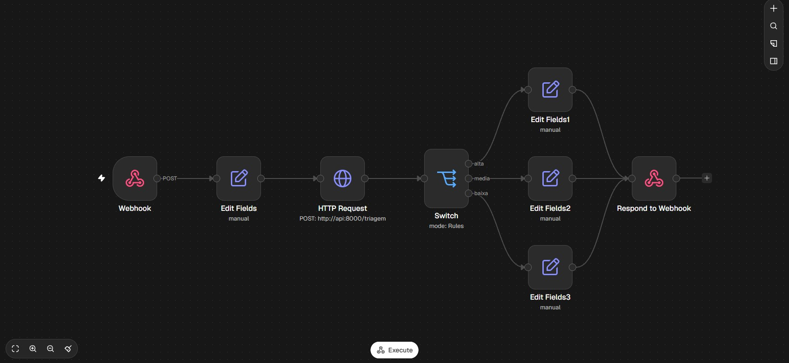

### 6.2. Execução Bem-Sucedida
Captura de tela comprovando a execução ponta a ponta concluída com sucesso e o tráfego dos dados entre os nodes:

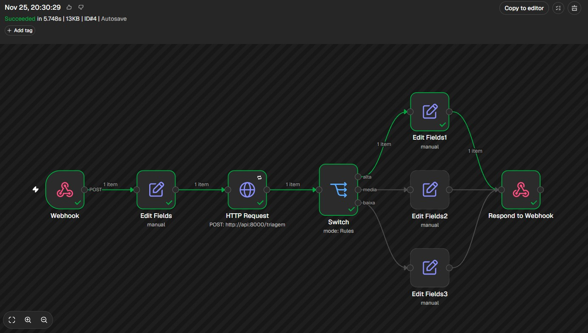

### 6.3. Configuração Interna e Resultados por Etapa (Nodes)

1. **Node `Webhook` (Entrada da Requisição):** configurado com método `POST`, path `triar-saude` e resposta delegada ao node `Respond to Webhook`.
   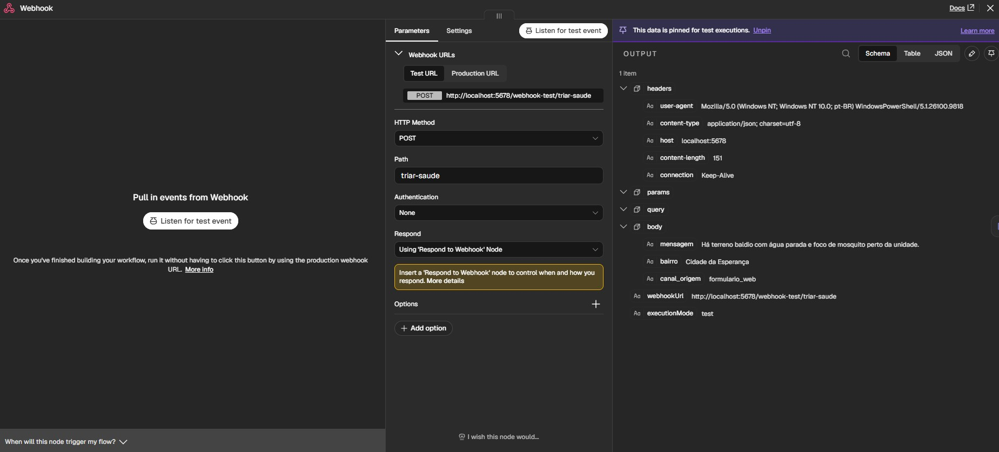

2. **Node `Edit Fields` (Normalização de Entrada):** extrai `mensagem`, `bairro` e `canal_origem` do corpo da requisição aplicando valores padrão quando necessário.
   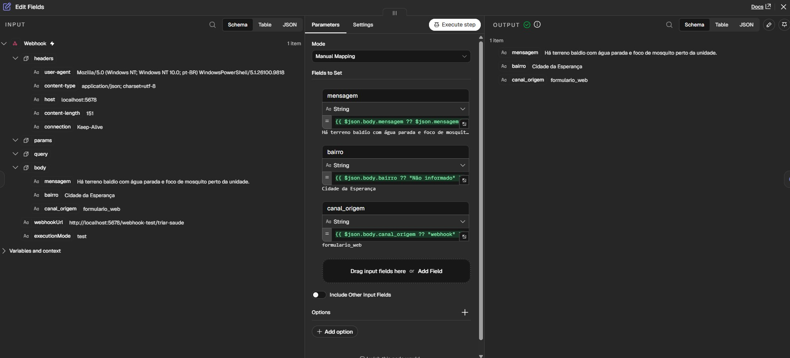

3. **Node `HTTP Request` (Integração com FastAPI + Gemini):** envia os dados normalizados via `POST` para `http://api:8000/triagem` e recebe o JSON estruturado da IA.
   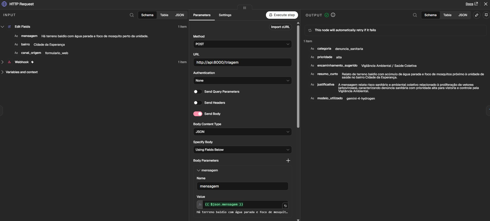
   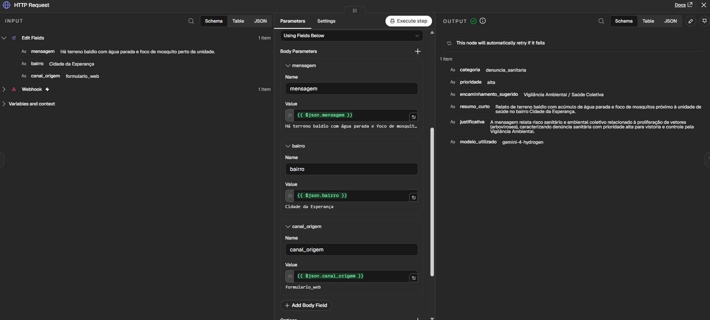

4. **Node `Switch` (Roteamento por Prioridade):** avalia o campo `prioridade` retornado pela API e direciona o fluxo para as saídas `alta`, `media` ou `baixa`.
   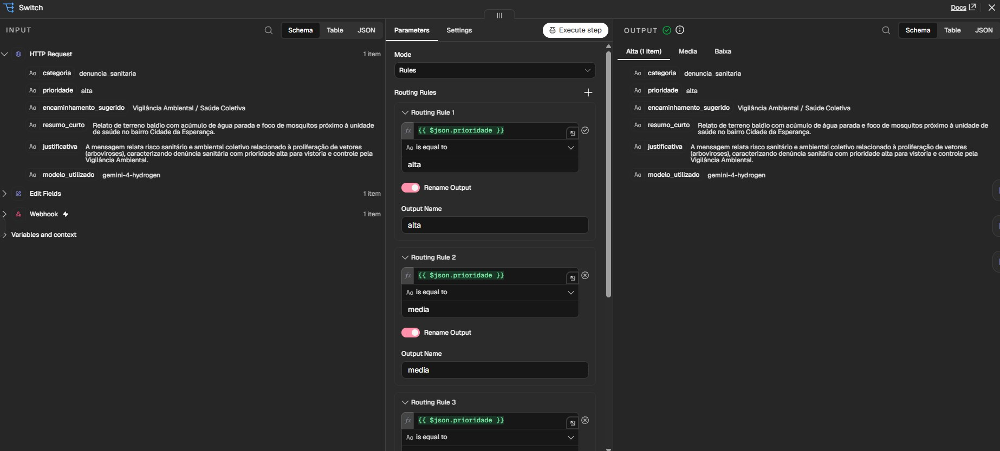
   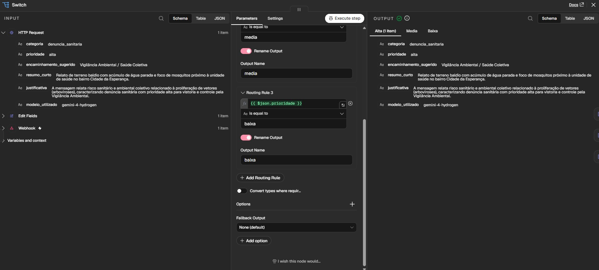

5. **Nodes `Edit Fields` por Prioridade (`Alta`, `Média` e `Baixa`):** montam os campos `fila_destino` e `acao_automatica` de acordo com a severidade e o encaminhamento sugerido pela IA.
   - **Rota Prioridade Alta:**
     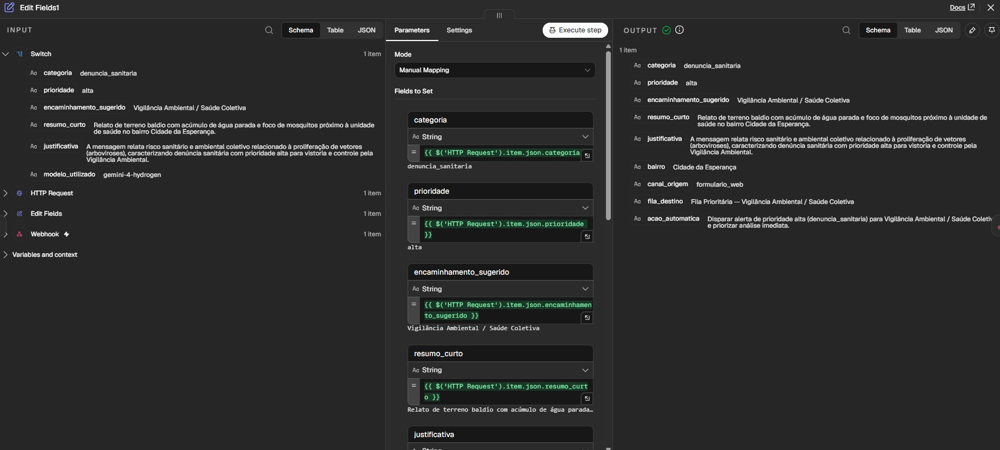
     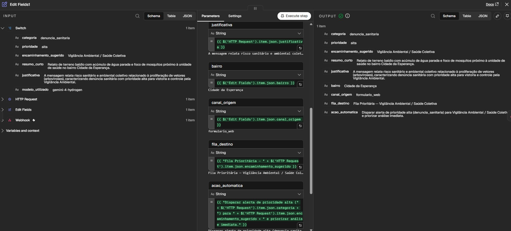
   - **Rota Prioridade Média:**
     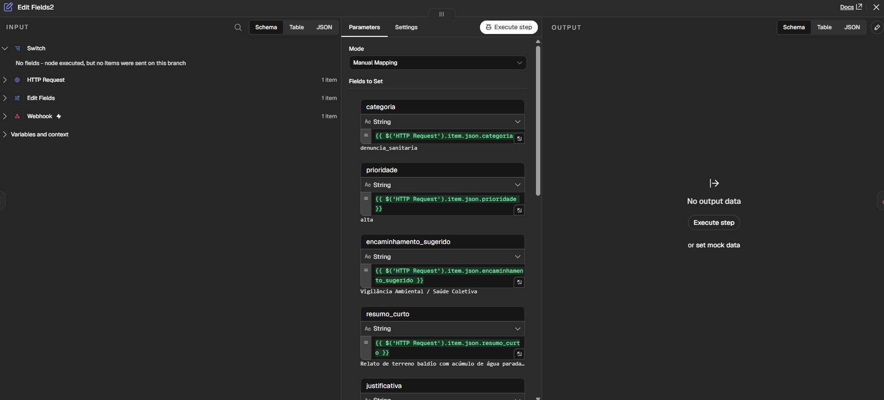
     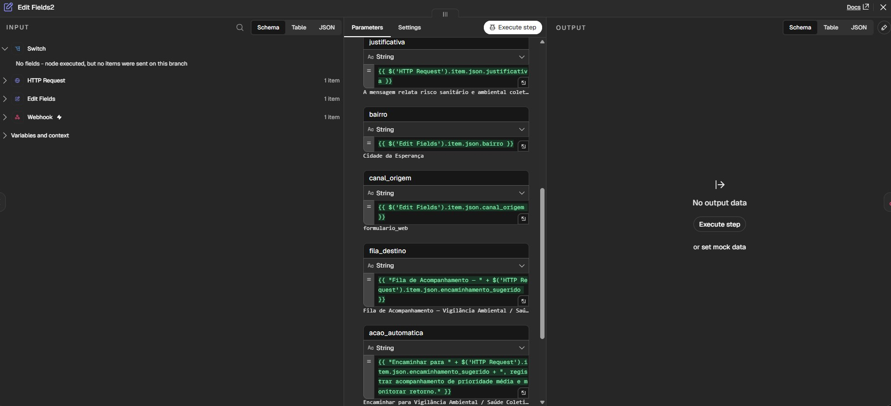
   - **Rota Prioridade Baixa:**
     
     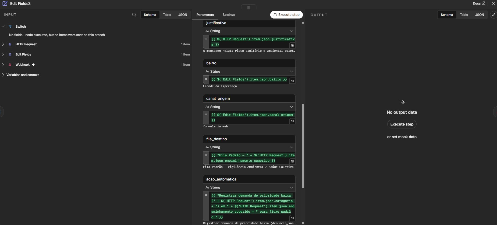

6. **Node `Respond to Webhook` (Resposta Consolidada):** devolve ao cliente o JSON final processado pela automação.
   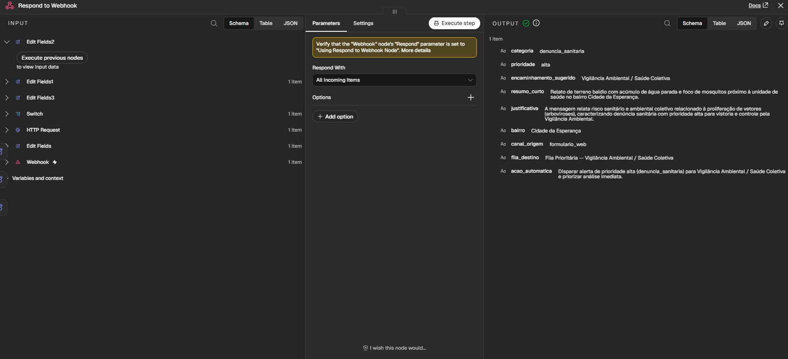

---

## 7. Como Executar

### Pré-requisitos
- **Docker** e **Docker Compose** instalados (recomendado) ou **Python 3.12+** para execução local da API
- Uma chave válida da **API do Gemini** (Google AI Studio)

### 7.1. Configuração das Variáveis de Ambiente

1. Clone o repositório:
   ```bash
   git clone https://github.com/igorrgabr/triar-saude.git
   cd triar-saude
   ```

2. Crie o arquivo `.env` a partir do modelo `.env.example` (nunca versione o arquivo `.env` com chaves reais):
   ```bash
   cp .env.example .env
   ```

3. Edite o `.env` e informe sua chave da API do Gemini e o modelo desejado:
   ```env
   GEMINI_API_KEY=sua_chave_gemini_aqui
   GEMINI_MODEL=gemini-4-hydrogen
   APP_ENV=development
   APP_HOST=0.0.0.0
   APP_PORT=8000
   N8N_PORT=5678
   N8N_TIMEZONE=America/Fortaleza
   ```

### 7.2. Execução com Docker Compose (API + n8n)

1. Construa a imagem e suba os containers em segundo plano:
   ```bash
   docker compose up --build -d
   ```

2. Verifique se os serviços estão ativos:
   - **Documentação interativa da API (Swagger):** `http://localhost:8000/docs`
   - **Healthcheck da API:** `http://localhost:8000/health`
   - **Interface do n8n:** `http://localhost:5678`

3. No primeiro acesso ao n8n:
   - Crie seu usuário local administrativo.
   - Clique em **Create Workflow**, abra o menu `...` (canto superior direito) e selecione **Import from File**, escolhendo o arquivo `n8n/workflow_triagem.json`.
   - Ative o workflow (ou clique em **Execute workflow** para testar na URL de teste).

4. Dispare uma requisição de teste para o Webhook:

   **Linux / macOS / Git Bash (`curl`):**
   ```bash
   curl -X POST "http://localhost:5678/webhook-test/triar-saude" \
     -H "Content-Type: application/json; charset=utf-8" \
     -d '{
       "mensagem": "Há terreno baldio com água parada e foco de mosquito perto da unidade.",
       "bairro": "Cidade da Esperança",
       "canal_origem": "formulario_web"
     }'
   ```

   **Windows (PowerShell com UTF-8):**
   ```powershell
   $body = [System.Text.Encoding]::UTF8.GetBytes('{"mensagem":"Há terreno baldio com água parada e foco de mosquito perto da unidade.","bairro":"Cidade da Esperança","canal_origem":"formulario_web"}')
   Invoke-RestMethod -Uri "http://localhost:5678/webhook-test/triar-saude" -Method Post -ContentType "application/json; charset=utf-8" -Body $body | ConvertTo-Json -Depth 4
   ```

5. Para encerrar os containers:
   ```bash
   docker compose down
   ```

### 7.3. Execução Local Apenas da API (Opcional)

Caso queira rodar a API FastAPI fora do Docker para desenvolvimento:

```bash
python -m venv .venv
# Linux/macOS:
source .venv/bin/activate
# Windows (PowerShell):
.venv\Scripts\Activate.ps1

pip install -r requirements.txt
uvicorn app.main:app --reload --host 0.0.0.0 --port 8000
```

---

## Limitações e Melhorias Futuras

- **Base de conhecimento oficial / RAG:** atualmente a triagem utiliza regras estruturadas no prompt; como evolução futura, pode ser conectada uma base documental verificada com fluxos e unidades da rede municipal/estadual de Natal/RN.
- **Persistência e notificações:** integração do fluxo n8n com banco de dados, planilhas ou canais de alerta (e-mail/Slack/Telegram) para histórico e acompanhamento operacional.